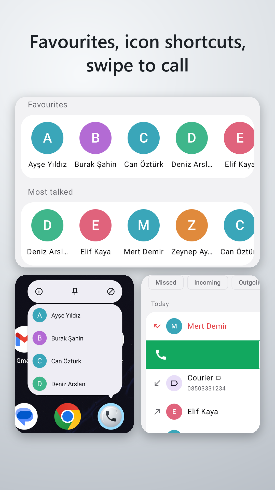
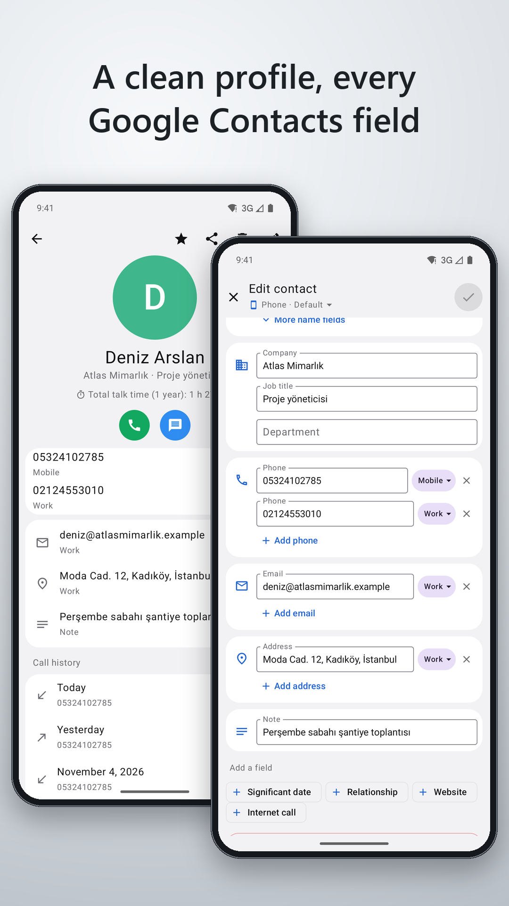
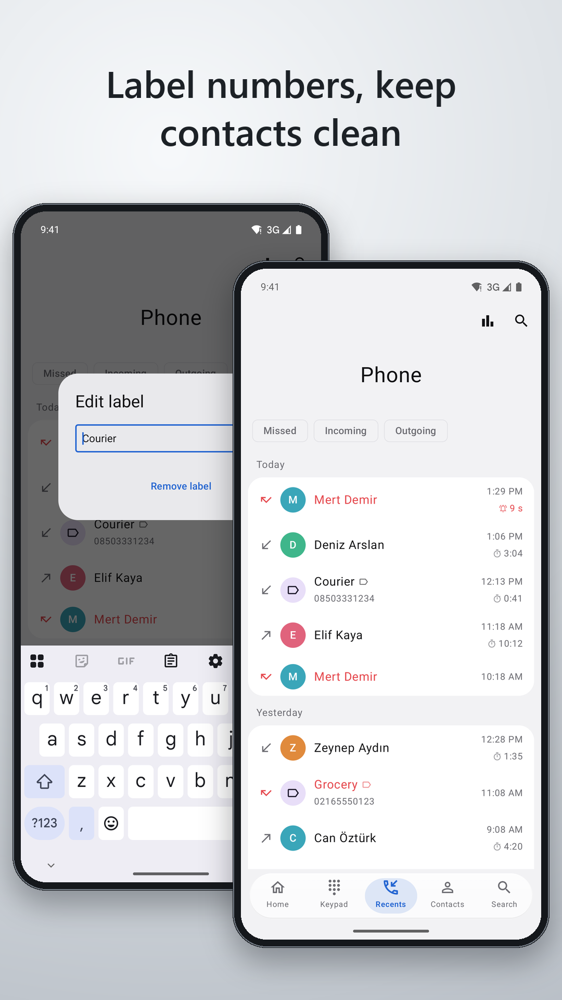
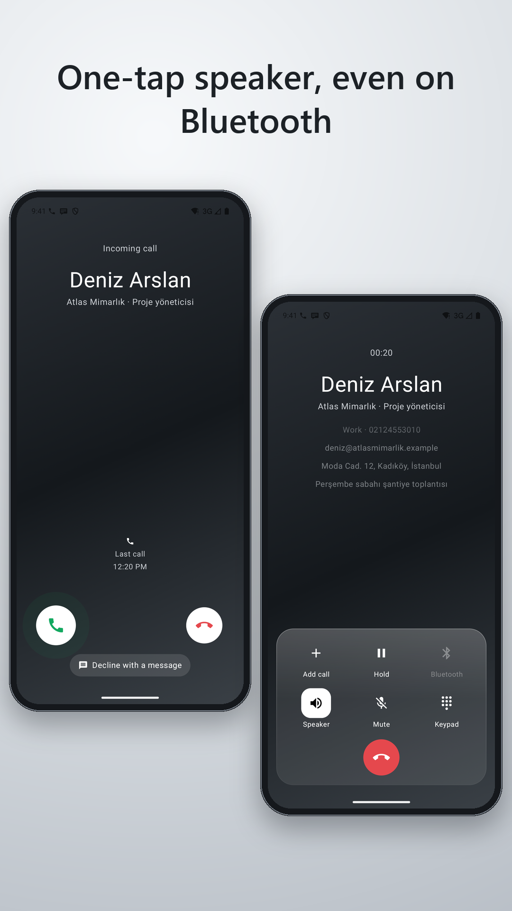
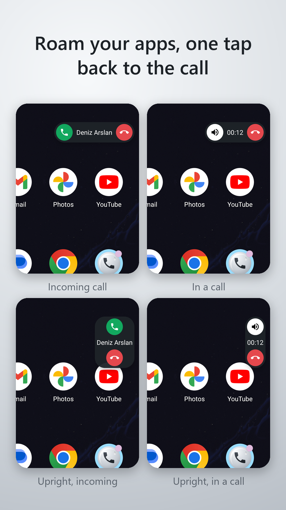
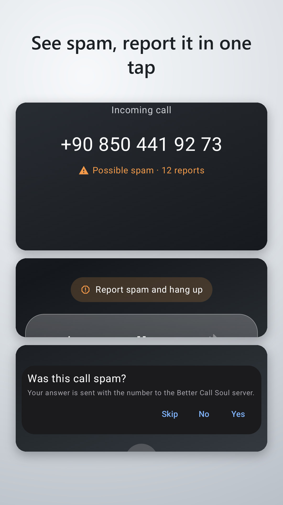
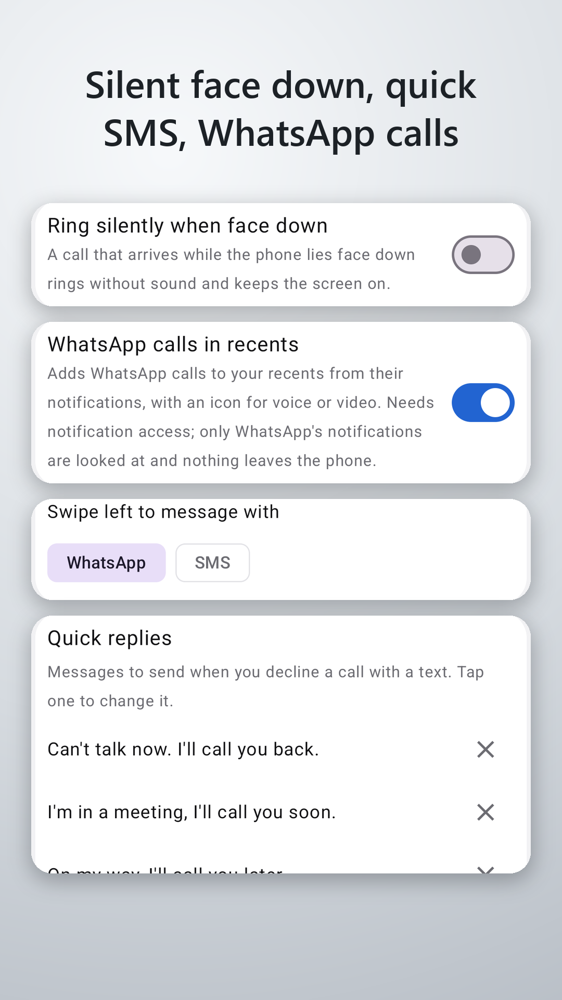
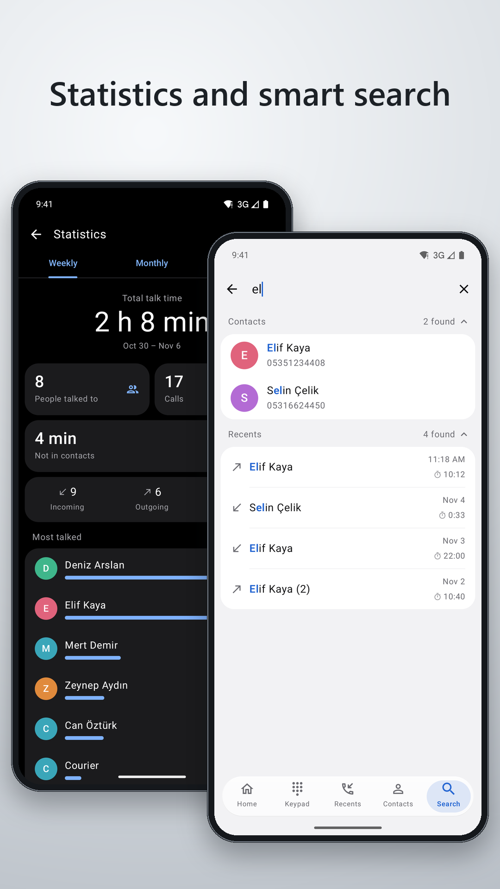

# Better Call Soul

Better Call Soul brings your phone and contacts together in one calm, fast app. No ads, no extra screens. Big, quiet layouts made for one hand: find who you want right away and know who's calling at a glance.

**[Website](https://callsoul.yesil.dev)** · **[Download APK](https://github.com/kyesil/callsoul/releases/latest)** · **[Google Play](https://play.google.com/store/apps/details?id=dev.yesil.callsoul)**

<p>
  
  
  
  
</p>
<p>
  
  
  
  
</p>

The people and numbers on these screens are fictional.

## Features

### Keep your contacts clean

The courier, the building manager, that one-time plumber: they don't belong in your address book. Give any number your own label and it shows by that name next time. Labels stay out of your contacts, so your list stays tidy.

### Swipe to call

- Swipe a row right to call, left to message. Left opens WhatsApp or SMS, your choice.
- Sliding rows of favourites and the people you talk to most: tap for the profile, double tap to call.
- Long press the app icon and your favourites are right there.
- The Search tab looks through contacts and calls at once and highlights the match.
- On the keypad, names (T9) and numbers are found as you type.

### Speaker in one tap

One tap switches to the speaker even with Bluetooth connected, and a second tap switches back. No digging through audio menus.

### The call pill

Moved to another app during a call? A small call pill comes with you at the edge of the screen. Turn on the speaker, hang up, or jump back to the call in one tap. Its side, size, button order and transparency are up to you.

### Against spam

- When an unknown number calls, you see spam reports and the caller's name if there is one.
- Worked it out mid-call? "Report spam and hang up" ends the call and reports the number in one tap.
- A "Was this spam?" question after the call helps the data grow.
- Numbers in your contacts are never sent, and you can turn the feature off in Settings.

### What's in settings

- Silent when face down: a phone lying on its face doesn't ring, and flipping it silences a ringing call.
- Decline with a message: write your own quick SMS replies.
- See WhatsApp calls in your recents, with an icon for voice or video. Optional; it needs notification access.
- How far from the edge swipes start, so they never clash with Android's back gesture.
- The call pill's look, animations, and four languages: Turkish, English, Arabic and Russian.

### Statistics

See by week, month and year how long you talked, how many people you talked to, how much of it was with numbers outside your contacts, and who you talk to most. It stays on your phone and is kept for a year at most.

### When a call comes in

- If you're using the phone, a small notification instead of a full screen, so nothing gets interrupted.
- Swipe to answer or decline, so it can't happen by accident in your pocket.
- Call back from the missed-call notification in one tap.

### During a call

- Hold, add a call, swap between calls and merge them.
- The contact's other numbers, e-mail, work details and note sit quietly under the name.
- The screen turns off when you hold the phone to your ear.

### Contacts

- Every Google Contacts field: phone, e-mail, address, birthday, relations, custom fields, labels, notes and a photo from the camera.
- Save to any of your Google accounts or to the phone, and move contacts between them.
- Select several and delete; deleted contacts wait 30 days in a recycle bin.
- Add a number to an existing contact, and share a contact as a card.
- Scan a business card QR code and the new contact fills itself in.

### Privacy

Your contacts and call history stay on your phone. The cloud spam lookup only covers numbers outside your contacts and can be turned off. See the privacy policy for details.

### Other highlights

- Missed calls show how long they rang, in red, in seconds.
- WhatsApp calls also show in a contact's call history, with their own icon.
- The Search tab keeps your recent searches, removed with a cross; long press results to delete several.
- Narrow your contacts to several sources; the choice stays, and the Search tab follows it.
- Open an entry and come back: the list is where you left it.
- Placing or answering a call grows a green circle into the call screen.
- Android 10 and up, dark theme, no ads, open source under GPL-3.0.

To use Better Call Soul, make it your default phone app.

## Developer's note

- This is a hobby project; I built it for my own use. Thanks to Opus 5.5.
- My contacts had turned into a dump, and apart from Samsung's I couldn't find a decent caller app on Android.
- I really wanted spam protection and smart caller ID. There's no free service for that, so we're trying to do the evaluation on a free Supabase account; there isn't much data yet.
- While building it I noticed that every manufacturer copied Apple and made an "island", each tied to its own operating system. They never agreed on a standard. That's why I added the call pill.

## License

[GPL-3.0](LICENSE). © 2026 [yesil.dev](https://yesil.dev).

Co-Authored-By: Claude Opus 5.5

## Structure

```
android/   Kotlin + Jetpack Compose
  app        screens: keypad, recents, contacts, call screen
  telecom    InCallService, call state, speaker switching, caller info
  island     call notification (CallStyle, Live Updates)
  calllog    call log, contacts, local database (labels)
  spam-core  number format and API client (pure Kotlin)
server/    TypeScript + Drizzle, Vercel functions, Supabase PostgreSQL
```

## Android

You need the JDK that comes with Android Studio (JDK 21).

```bash
cd android
./gradlew :spam-core:test :app:assembleDebug
adb install -r -g app/build/outputs/apk/debug/app-debug.apk
```

Every build sends its API requests to `https://callsoul.yesil.dev/api/`. To try a local development server, change the address when building and connect the phone to the server:

```bash
./gradlew :app:assembleDebug -Pbcs.apiUrl=http://localhost:3000
```

```bash
adb reverse tcp:3000 tcp:3000
```

On a phone without a voice line, the call screens can open with sample data (`incoming`, `spam`, `dialing`, `active`, `ended`):

```bash
adb shell am start -n dev.yesil.callsoul/com.bettercallsoul.call.CallPreviewActivity --es mode incoming
```

## Server

Copy `server/.env.example` to `.env` and fill it in.

```bash
cd server
npm install
npm run db:migrate
npm run dev
npm test
```

| Endpoint | Body | Purpose |
|---|---|---|
| `GET /api/health` | | Checks the database connection |
| `POST /api/lookup` | `{ number }` | Returns a number's spam status |
| `POST /api/report` | `{ number, deviceId, isSpam, category?, callerName? }` | Saves a user's vote |

Numbers are in E.164 format and are never put in URLs. One device gets one vote per number; a verdict needs at least 3 votes and a 70% majority.

On Vercel the project's root directory must be `server`, and the variables in `.env` must be added to the project settings. The region in `vercel.json` should match the database.
